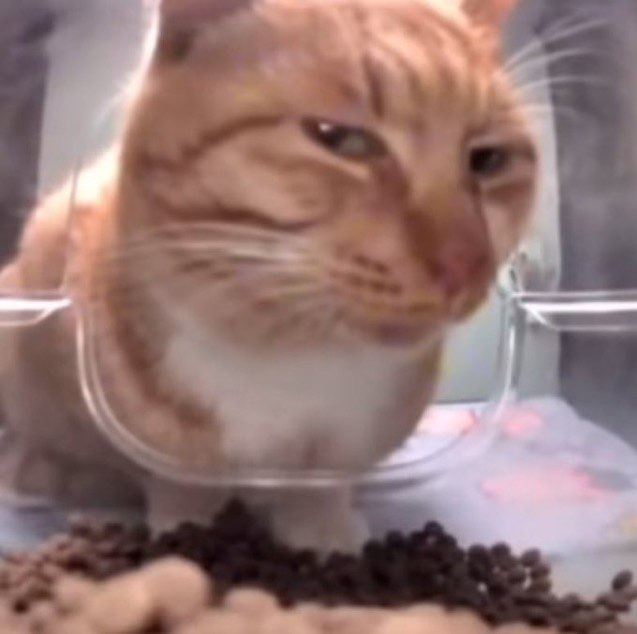

# gavn.sh

<p align="center">
  
</p>

A tiny Go site: a cat on a black page. Rub the cat to reveal the menu.

## Run locally

```sh
go run .
```

Then open http://localhost:8080. Set `PORT` to use a different port.

## Docker

```sh
docker build -t gavn-sh .
docker run -p 8080:8080 gavn-sh
```
